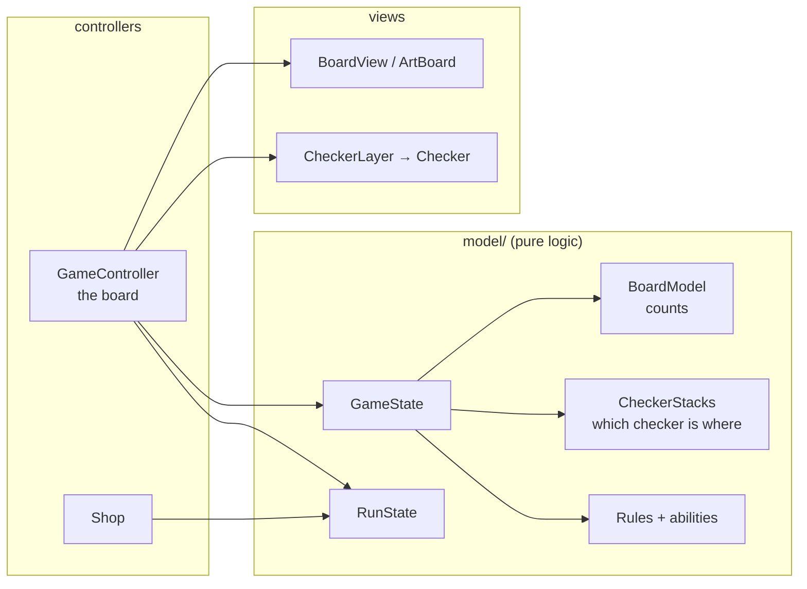
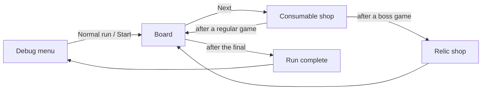

# Architecture

The code is split in three layers. The **model** is pure game logic: the
board, the checkers, the rules and abilities, the run, the items. It knows
nothing about the screen, so the tests (and later the AI) use it alone. The
**controllers** turn clicks into moves and are the only code that changes the
model. The **views** draw what the model says.

## Folders

| Folder | What |
|--------|------|
| `model/rules/` | The board, the checkers, moves, `Rules` and the abilities of special checkers |
| `model/run/` | The run, the biomes, the numbers to balance |
| `model/items/` | Consumables and the catalog of items |
| `scenes/game/` | The board screen and its controller |
| `scenes/shop/` | The consumable shop and the relic shop |
| `scenes/screens/` | Game over, the pause menu |
| `debug/` | The debug menu and the F1 panel |
| `tests/`, `tools/` | The automated tests and the checks |

## Scenes

The details (every class, the data flow of one move) are in the game
repository's `docs/reference/`.
