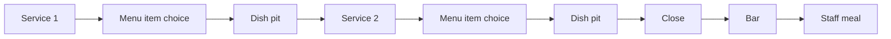

# Run structure

How a run is organised: the three days, the games played each day, and what
happens between games. For the rules of a single game, see
[Core rules](core-rules.md).

## At a glance

- A **run** lasts 3 days: **Thursday**, **Friday** and **Saturday**, then the
  final boss.
- Each day, the player faces one [biome](../biomes/index.md): 2 **services**
  (games against the biome's minions), then the **close** (the game against
  the biome's boss).
- There are 5 biomes; a run uses 3 of them.
- After the third day, the player faces the [final boss](../final-boss.md),
  [The Pig](../characters/the-pig.md), the owner.
- A run has **10 games** in total.

!!! note "TBD"
    How the 3 biomes of a run are chosen among the 5.

## One day

## Order of a run

See [decision 0004](../decisions/0004-run-order.md).

0. **Before the run:** menu item choice, then the [bar](../shops.md#bar) for
   a starting relic.
1. **First biome** (Thursday)
    1. **Service 1**, then menu item choice, then the
       [dish pit](../shops.md#dish-pit).
    2. **Service 2**, then menu item choice, then the dish pit.
    3. **The close**, then the bar.
    4. **Staff meal:** heal to full HP.
2. **Second biome** (Friday): same as the first.
3. **Third biome** (Saturday): same as the first.
4. **Final boss:** [The Pig](../final-boss.md). The run ends after it: no shop.

!!! note "TBD"
    Whether the starting relic is free or bought with the starting 10 tips
    (the cheapest relic costs 8). See
    [open questions](../decisions/open-questions.md#money-system).

## Game numbering

| Game       | Day      | Game type  | Opponent                    |
|------------|----------|------------|-----------------------------|
| 1.1        | Thursday | Service    | The day's biome minions     |
| 1.2        | Thursday | Service    | The day's biome minions (+ a few boss orders) |
| 1.B        | Thursday | Close      | The day's biome boss        |
| 2.1        | Friday   | Service    | The day's biome minions     |
| 2.2        | Friday   | Service    | The day's biome minions (+ a few boss orders) |
| 2.B        | Friday   | Close      | The day's biome boss        |
| 3.1        | Saturday | Service    | The day's biome minions     |
| 3.2        | Saturday | Service    | The day's biome minions (+ a few boss orders) |
| 3.B        | Saturday | Close      | The day's biome boss        |
| Final boss | —        | Final boss | [The Pig](../final-boss.md) |

Enemies get stronger each day: see
[How a biome works](../biomes/index.md#how-a-biome-works).

## Between games

| Stop | What happens | When | Run by |
|------|--------------|------|--------|
| **Menu item choice** | Pick 1 of 3 menu items, swapped into the menu. See [Drafting & curses](drafting-and-curses.md). | Before the run, after each service | — |
| **[Dish pit](../shops.md#dish-pit)** | Buy consumables with tips. | After each service | [The Elephant](../characters/the-elephant.md) |
| **[Bar](../shops.md#bar)** | Buy a relic with tips ("shift beer"). | Before the run, after each close | [The Octopus](../characters/the-octopus.md) |
| **[Staff meal](../shops.md#staff-meal)** | Heal to full HP. | End of each day, after the bar | [The Saint Bernard](../characters/the-saint-bernard.md) |
| **[Smoke break](../shops.md#smoke-break)** | The pause menu. | Any time | — |

There is no menu item choice and no dish pit after a close.
